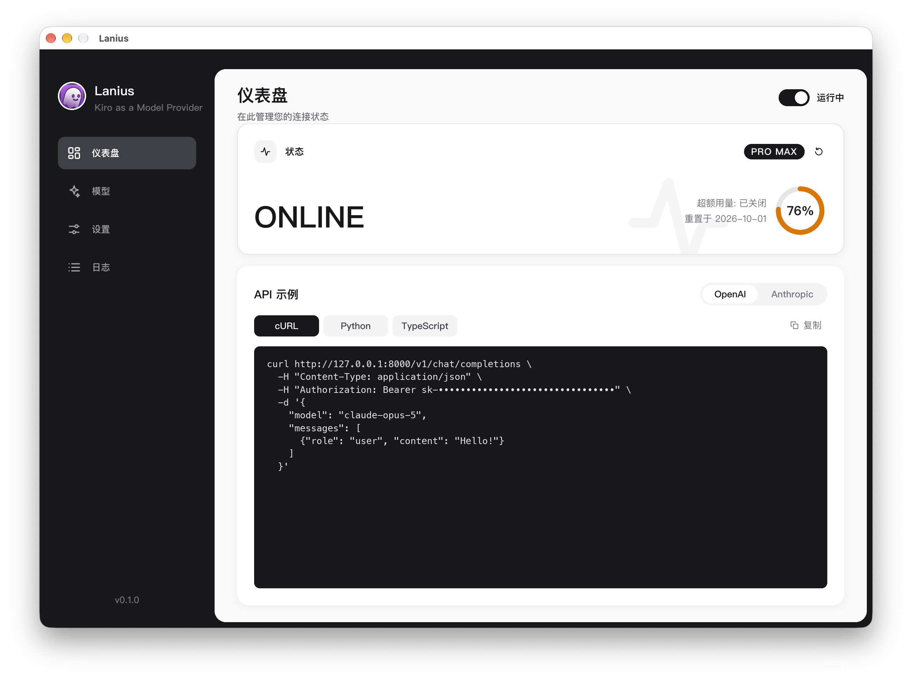

> [English](README.md) | 简体中文

# Lanius

通过 OpenAI 和 Anthropic 兼容 API 使用 Kiro。Lanius 让兼容的客户端、SDK 和编程工具通过本地或自托管网关连接到 Kiro。



## 快速开始

本地使用建议选择桌面应用；服务端、Docker 和自动化场景请使用 CLI。

### 桌面应用

从 [GitHub Releases](https://github.com/dennis0700/lanius/releases) 下载对应平台的安装包，打开 Lanius 后：

1. 在“设置”中填入 Kiro API Key。
2. 除非需要让其他设备连接，否则保持默认地址 `127.0.0.1:18000`。
3. 将应用显示的连接信息复制到你的客户端。

### CLI 或 Linux 服务端

下载 Linux Release，或从源码构建 CLI。启动前需要设置一个强度足够的客户端密钥，以及一种 Kiro 凭据来源。对于服务器，Kiro API Key 是最简单的方式。

```sh
export PROXY_API_KEY="$(openssl rand -hex 32)"
export KIRO_API_KEY="ksk_your_kiro_key"
export KIRO_REGION="us-east-1"
export SERVER_HOST="127.0.0.1"

lanius
```

如果从本仓库源码运行，请将 `lanius` 替换为 `cargo run -p lanius-cli`。从源码构建需要 Rust 1.85 或更高版本。长期运行的 Linux 服务请参阅 [systemd 部署指南](docs/zh-CN/deployment.md)。

### 验证服务

```sh
curl http://127.0.0.1:18000/health

curl http://127.0.0.1:18000/v1/models \
  -H "Authorization: Bearer $PROXY_API_KEY"
```

## 连接客户端

在客户端中使用 `PROXY_API_KEY` 作为 API Key。这是保护 Lanius 的密钥，不是 Kiro API Key。

| 客户端 | Base URL | Messages 地址 |
|---|---|---|
| OpenAI 兼容客户端 | `http://127.0.0.1:18000/v1` | `POST /chat/completions` 或 `POST /responses` |
| Anthropic 兼容客户端 | `http://127.0.0.1:18000` | `POST http://127.0.0.1:18000/v1/messages` |

例如，使用 OpenAI 兼容接口：

```sh
curl http://127.0.0.1:18000/v1/chat/completions \
  -H "Authorization: Bearer $PROXY_API_KEY" \
  -H "Content-Type: application/json" \
  -d '{"model":"claude-sonnet-4.6","messages":[{"role":"user","content":"Hello"}]}'
```

Lanius 还支持 `GET /v1/models`、`POST /v1/responses`、`POST /v1/messages/count_tokens`、`GET /usage` 和 `GET /account`。请求格式请参阅 [API 与客户端说明](docs/zh-CN/request-flow.md)。

### Codex CLI

Codex 使用 OpenAI Responses API。将 provider URL 配置为 `http://127.0.0.1:18000/v1`，并通过环境变量提供 `PROXY_API_KEY`。完整步骤见 [Codex CLI 配置指南](docs/zh-CN/codex.md)。

## 凭据与配置

设置 `PROXY_API_KEY` 后，从以下方式中选择一种 Kiro 凭据来源：

| 配置项 | 用途 |
|---|---|
| `KIRO_API_KEY` | 推荐用于服务器和容器。在 [Kiro](https://app.kiro.dev) 创建 `ksk_...` Key。 |
| `KIRO_CREDS_FILE` | 使用已有的 Kiro 桌面端凭据文件。 |
| `KIRO_CLI_DB_FILE` | 使用已有的 Kiro CLI 登录数据库。 |
| `REFRESH_TOKEN` | 其他来源不可用时，使用已有的 refresh token。 |

`KIRO_REGION` 必须与 Kiro Key 或账户所在区域一致，默认值是 `us-east-1`。全部配置项请参阅 [配置参考](docs/zh-CN/configuration.md)。

## 部署方式

- [Linux systemd](docs/zh-CN/deployment.md)
- [Docker 与 Kubernetes](docs/zh-CN/container.md)
- [桌面应用说明](docs/zh-CN/gui.md)

## 安全提示

- 为 `PROXY_API_KEY` 生成独立的随机值，不要使用示例值。
- 不要把 Kiro 凭据和 `PROXY_API_KEY` 提交到 Git，也不要发到截图、日志或 Issue 中。服务端请使用权限受限的环境变量文件。
- 客户端在同一主机上运行，或前面已有反向代理时，请绑定到 `127.0.0.1`。`0.0.0.0` 会暴露到所有网络接口。
- Lanius 使用 HTTP。流量离开主机或集群时，请在反向代理、Ingress 或网关处配置 TLS 和访问控制。
- `/health` 为健康检查开放，其他接口都需要 `PROXY_API_KEY`。

## 更新

桌面应用可在设置中检查更新。CLI 请运行 `lanius update`；使用 `lanius update --check` 仅检查而不安装。

## 更多文档

高级配置、兼容性说明和故障排查请参阅 [docs/zh-CN/](docs/zh-CN)。

## 许可证

AGPL-3.0，详见 [LICENSE](LICENSE)。
