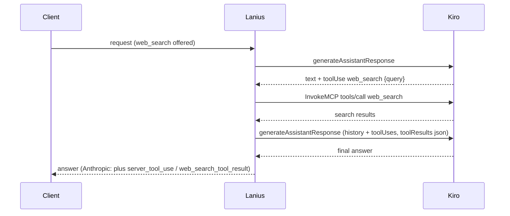

# Request Flow

This traces one request end-to-end for both supported client protocols.
Line/file references point at the handler functions doing the work.

## Endpoints

| Method & path | Handler | Auth check |
|---|---|---|
| `GET /health` | `server::app` (inline) | none |
| `GET /`, `GET /v1/models` | `api::openai::routes::{root,models}` | Bearer `PROXY_API_KEY` |
| `POST /v1/chat/completions` | `api::openai::routes::chat_completions` | Bearer `PROXY_API_KEY` |
| `POST /v1/responses` | `api::openai::responses::routes::create_response` | Bearer `PROXY_API_KEY` |
| `POST /v1/messages` | `api::anthropic::routes::messages` | `x-api-key` / Bearer `PROXY_API_KEY` |
| `POST /v1/messages/count_tokens` | `api::anthropic::routes::count_tokens_endpoint` | same as above |
| `GET /usage`, `GET /account` | `server::{usage,account}` | Bearer `PROXY_API_KEY` |

All routes except `/health` require the configured `PROXY_API_KEY`; CORS is
restricted to `localhost`/`127.0.0.1` origins (`server::local_cors`).

## OpenAI: `POST /v1/chat/completions`

1. **`server::app`** — the request passes through `CatchPanicLayer`,
   `TraceLayer`, `local_cors`, and `model_id_format_middleware` (which only
   touches `/v1/models` responses) before reaching the router.
2. **`api::openai::routes::chat_completions`** deserializes the body into
   `ChatCompletionRequest`, checks the bearer token, then:
   - Resolves `request.model` to a concrete Kiro model id via
     `OpenAiState::model_resolver` (`ModelResolver::resolve` — see
     [model-catalog.md](model-catalog.md)).
   - Offers the model a `web_search` tool if `config.web_search_enabled`
     and the client didn't declare its own `web_search` function
     (`inject_web_search_tool`). Lanius executes its calls itself (see
     [Server-side web search](#server-side-web-search)), so the client only
     receives the final answer.
   - Rewrites the message list to prepend a truncation-recovery notice if
     `TruncationStore` has a pending record for this conversation
     (`inject_truncation_recovery` — see [truncation.md](truncation.md)).
   - Calls `prepare_openai_request`, which converts the request via
     `convert::build_kiro_payload` (see [conversion.md](conversion.md)) and
     builds an `OpenAiFormatContext` carrying everything the response/SSE
     layer will need later (model id, model cache, original messages/tools
     for fallback token estimation, conversation id, truncation store, tool
     name aliases).
3. **Upstream call** — `KiroHttpClient::request_with_retry` (or
   `request_bytes_with_retry` for the buffered path) POSTs the payload to
   `config.generate_assistant_response_url()`, retrying per the policy in
   [auth.md](auth.md#retry-and-refresh-policy).
4. **Streaming branch** (`request.stream == true`): `streaming_response`
   wraps the upstream byte stream with `preflight_upstream`/
   `preflight_first_byte` (surfacing HTTP-level errors as a proper SSE error
   frame instead of a silently empty stream), then
   `api::openai::sse::encode_openai_sse` turns the decoded `KiroEvent`
   stream into `chat.completion.chunk` SSE frames (see
   [streaming.md](streaming.md)).
5. **Buffered branch**: `api::openai::sse::collect_openai_response` drives
   `upstream::collect_stream_to_result` to completion, then
   `response_value_from_result` assembles the final JSON body: restores
   original tool names (see [compatibility.md](compatibility.md)), detects
   truncation and records a recovery entry if needed, and computes token
   usage (see [truncation.md](truncation.md) and the tokenizer notes in
   [architecture.md](architecture.md)).

## OpenAI: `POST /v1/responses`

Same pipeline as Chat Completions (auth, API-key affinity/failover,
model resolution, truncation recovery, server-side `web_search`), with
Responses-specific conversion and output:

1. **`api::openai::responses::routes::create_response`** deserializes a
   `ResponsesRequest`. Lanius stores nothing, so `previous_response_id`
   (and `item_reference` input items) are rejected with 400; clients send
   the full conversation in `input`. Session affinity prefers
   `x-session-id`, then `prompt_cache_key`, then `user`.
2. **`convert::responses_to_kiro`** converts the input items *directly* to
   `UnifiedMessage`/`UnifiedTool` and calls the shared
   `build_kiro_payload` core — no Chat Completions request is built in
   between. `instructions` and `system`/`developer` messages become the
   system prompt; `function_call`/`function_call_output` (and
   `custom_tool_call`/`custom_tool_call_output`) become Kiro `toolUses` /
   `toolResults`; `reasoning` items and built-in tool records are skipped.
   `custom` (freeform) tools are offered as a function with one `input`
   string and mapped back to `custom_tool_call` items.
3. **`api::openai::responses::sse::ResponseBuilder`** folds the
   `SearchLoop` event stream into output items (`reasoning`, `message`,
   `web_search_call`, `function_call`/`custom_tool_call`). Streaming
   requests get the semantic SSE events (`response.created`,
   `response.output_item.added`, `response.output_text.delta`, ...,
   `response.completed` / `response.incomplete` / `response.failed`);
   non-streaming requests run the same builder and get the final
   `response` object.

## Anthropic: `POST /v1/messages`

Same shape, with protocol-specific differences:

1. **`api::anthropic::routes::messages`** checks headers via
   `verify_headers` (accepts either `x-api-key` or a Bearer
   `Authorization` header, in constant time — see
   `authentication_is_constant_time_shape_and_allows_optional_version` in
   `routes.rs`), rejects empty message lists, applies truncation recovery
   (`apply_truncation_recovery`). Claude Code / Cowork WebSearch
   sub-requests (only server `web_search_*` tools, with the tool forced or
   Claude Code's `Perform a web search for the query:` prefix,
   `is_search_subrequest`) are answered directly from Kiro's native search
   as `server_tool_use` + `web_search_tool_result` + text, without calling
   the model. In any other request the server tool is replaced by a
   model-facing `web_search` tool (`replace_server_tool`, budget = the
   tool's `max_uses`, default 5) that Lanius executes, see
   [Server-side web search](#server-side-web-search). Kiro's
   `CONTENT_LENGTH_EXCEEDS_THRESHOLD` is returned as `400
   invalid_request_error` with `prompt is too long: N tokens > M maximum`
   so Claude clients trigger auto-compaction.
2. `prepare_request` converts via `convert::anthropic_to_kiro` and builds a
   `PreparedRequest` (payload + `RequestTokenInput` for fallback token
   estimation + the per-request `ToolNameAliases`).
3. **Streaming branch**: `stream_response` drives
   `api::anthropic::sse::AnthropicSseFormatter`, a stateful machine that
   emits Anthropic's specific event sequence (`message_start` ->
   `content_block_start/delta/stop` per block -> `message_delta` ->
   `message_stop`), including periodic `ping` events
   (`DEFAULT_PING_INTERVAL`) while waiting on slow upstream output.
4. **Buffered branch**: `response_from_stream_result` (in
   `api::anthropic::sse`) assembles the `content` array in the fixed order
   Anthropic expects (thinking block first if present, then text, then
   tool-use blocks), computes usage (preferring Kiro's context-usage signal
   when available — see `calculate_tokens_from_context_usage` in
   `tokenizer.rs`), and picks `stop_reason` (`max_tokens` if truncated,
   `tool_use` if any tool was called, else `end_turn`).

`POST /v1/messages/count_tokens` skips the upstream call entirely: it
converts the request the same way, then returns
`tokenizer::estimate_request_tokens`'s result directly.

## Error surfacing

Errors at any stage (bad request, auth failure, upstream non-2xx, transport
failure, timeout) become a `GatewayError` (see `error.rs`), which each
route's `gateway_error_response`/`gateway_response` helper renders into the
target protocol's own error envelope shape — OpenAI's `{"error": {...}}` or
Anthropic's `{"type": "error", "error": {...}}` — never leaking raw upstream
response bodies that might contain credentials.

## Server-side web search

Kiro's models can call `web_search`, but, as in the Kiro CLI, the caller
must run the search and send the results back. `api::search_loop::SearchLoop`
does this for both APIs:

- Search: `KiroHttpClient::web_search` sends JSON-RPC `tools/call` through
  `AmazonCodeWhispererStreamingService.InvokeMCP` on the runtime host, like
  the Kiro CLI.
- Continuation: the current user turn moves into history, followed by an
  assistant turn with the round's text and `toolUses`; a new empty user turn
  carries `toolResults` with the raw result document as a `json` block.
- Rounds that also call client tools end the loop; those calls reach the
  client and the `web_search` calls of that round are dropped. Calls beyond
  the budget get a `max_uses_exceeded` error result, and the loop stops one
  round later. Search failures are reported to the model as error results
  instead of failing the request.
- Enterprise policy: Kiro does not enforce the console's "Web search and
  web fetch tools" switch on `InvokeMCP`, so Lanius applies it like the Kiro
  CLI. For accounts with a profile ARN it reads `GetProfile`
  (`management.<region>.kiro.dev`); `optInFeatures.webTools.toggle == "OFF"`
  means no search tool is offered and Claude Code WebSearch sub-requests get
  `403 permission_error`. A missing field or a failed lookup keeps search
  enabled. The verdict is cached for 5 minutes.
- Output: OpenAI clients see only text (rounds separated by a blank line).
  Anthropic clients additionally get a `server_tool_use` +
  `web_search_tool_result` pair per search (errors as
  `web_search_tool_result_error`) and `usage.server_tool_use.web_search_requests`.

