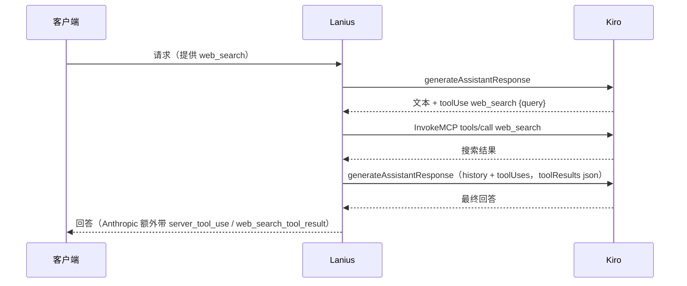

> [English](../request-flow.md) | 简体中文

# 请求流程

本文针对两种受支持的客户端协议，端到端地追踪一次请求。
文中的行/文件引用指向实际执行工作的 handler 函数。

## 端点

| 方法与路径 | Handler | 认证校验 |
|---|---|---|
| `GET /health` | `server::app`（内联） | 无 |
| `GET /`, `GET /v1/models` | `api::openai::routes::{root,models}` | Bearer `PROXY_API_KEY` |
| `POST /v1/chat/completions` | `api::openai::routes::chat_completions` | Bearer `PROXY_API_KEY` |
| `POST /v1/messages` | `api::anthropic::routes::messages` | `x-api-key` / Bearer `PROXY_API_KEY` |
| `POST /v1/messages/count_tokens` | `api::anthropic::routes::count_tokens_endpoint` | 同上 |
| `GET /usage`, `GET /account` | `server::{usage,account}` | Bearer `PROXY_API_KEY` |

除 `/health` 外，所有路由都要求提供已配置的 `PROXY_API_KEY`；CORS 仅允许 `localhost`/`127.0.0.1` 来源（`server::local_cors`）。

## OpenAI：`POST /v1/chat/completions`

1. **`server::app`**：请求在到达 router 之前依次经过 `CatchPanicLayer`、`TraceLayer`、`local_cors` 和 `model_id_format_middleware`（后者只处理 `/v1/models` 的响应）。
2. **`api::openai::routes::chat_completions`** 将请求体反序列化为 `ChatCompletionRequest`，校验 bearer token，然后：
   - 通过 `OpenAiState::model_resolver`（`ModelResolver::resolve`，见 [model-catalog.md](model-catalog.md)）将 `request.model` 解析为具体的 Kiro 模型 id。
   - 如果启用了 `config.web_search_enabled`，且客户端没有自己声明 `web_search` 函数，则为模型提供一个 `web_search` 工具（`inject_web_search_tool`）。它的调用由 Lanius 自己执行（见[服务端 Web 搜索](#服务端-web-搜索)），客户端只收到最终回答。
   - 如果 `TruncationStore` 中有该会话待处理的记录，则改写消息列表，在前面加上一条截断恢复提示（`inject_truncation_recovery`，见 [truncation.md](truncation.md)）。
   - 调用 `prepare_openai_request`：它通过 `convert::build_kiro_payload`（见 [conversion.md](conversion.md)）转换请求，并构建一个 `OpenAiFormatContext`，其中携带响应/SSE 层稍后需要的所有信息（模型 id、模型缓存、用于回退 token 估算的原始消息/工具、会话 id、截断存储、工具名别名）。
3. **上游调用**：`KiroHttpClient::request_with_retry`（缓冲路径下为 `request_bytes_with_retry`）将 payload POST 到 `config.generate_assistant_response_url()`，并按照 [auth.md](auth.md#重试与刷新策略上游客户端) 中的策略进行重试。
4. **流式分支**（`request.stream == true`）：`streaming_response` 用 `preflight_upstream`/`preflight_first_byte` 包装上游字节流（将 HTTP 层面的错误以规范的 SSE 错误帧呈现，而不是静默地返回空流），随后 `api::openai::sse::encode_openai_sse` 将解码后的 `KiroEvent` 流转换为 `chat.completion.chunk` SSE 帧（见 [streaming.md](streaming.md)）。
5. **缓冲分支**：`api::openai::sse::collect_openai_response` 驱动 `upstream::collect_stream_to_result` 运行至结束，然后由 `response_value_from_result` 组装最终的 JSON 响应体：恢复原始工具名（见 [compatibility.md](compatibility.md)），检测截断并在需要时记录恢复条目，并计算 token 用量（见 [truncation.md](truncation.md) 以及 [architecture.md](architecture.md) 中关于 tokenizer 的说明）。

## Anthropic：`POST /v1/messages`

整体结构相同，但存在协议特有的差异：

1. **`api::anthropic::routes::messages`** 通过 `verify_headers` 校验 header（接受 `x-api-key` 或 Bearer `Authorization` header，并以常数时间比较，见 `routes.rs` 中的 `authentication_is_constant_time_shape_and_allows_optional_version`），拒绝空消息列表，应用截断恢复（`apply_truncation_recovery`）。Claude Code / Cowork 的 WebSearch 子请求（只有服务端 `web_search_*` 工具，且强制使用该工具或带有 Claude Code 的 `Perform a web search for the query:` 前缀，见 `is_search_subrequest`）直接走 Kiro 原生搜索，以 `server_tool_use` + `web_search_tool_result` + 文本返回，不调用模型。其他请求中，服务端工具会被替换为一个面向模型的 `web_search` 工具（`replace_server_tool`，次数上限取该工具的 `max_uses`，默认 5），由 Lanius 执行，见[服务端 Web 搜索](#服务端-web-搜索)。Kiro 的 `CONTENT_LENGTH_EXCEEDS_THRESHOLD` 以 `400 invalid_request_error`、`prompt is too long: N tokens > M maximum` 返回，以便 Claude 客户端触发自动 Compact。
2. `prepare_request` 通过 `convert::anthropic_to_kiro` 进行转换，并构建一个 `PreparedRequest`（payload + 用于回退 token 估算的 `RequestTokenInput` + 每个请求独立的 `ToolNameAliases`）。
3. **流式分支**：`stream_response` 驱动 `api::anthropic::sse::AnthropicSseFormatter`。这是一个有状态的状态机，按 Anthropic 规定的事件顺序输出（`message_start` -> 每个块的 `content_block_start/delta/stop` -> `message_delta` -> `message_stop`），并在等待较慢的上游输出时周期性地发送 `ping` 事件（`DEFAULT_PING_INTERVAL`）。
4. **缓冲分支**：`response_from_stream_result`（位于 `api::anthropic::sse`）按 Anthropic 期望的固定顺序组装 `content` 数组（若存在 thinking 块则放在最前，然后是文本，最后是 tool-use 块），计算用量（若可用则优先使用 Kiro 的 context-usage 信号，见 `tokenizer.rs` 中的 `calculate_tokens_from_context_usage`），并选择 `stop_reason`（被截断时为 `max_tokens`，调用了任意工具时为 `tool_use`，否则为 `end_turn`）。

`POST /v1/messages/count_tokens` 完全跳过上游调用：它以同样的方式转换请求，然后直接返回 `tokenizer::estimate_request_tokens` 的结果。

## 错误呈现

任何阶段的错误（错误请求、认证失败、上游非 2xx、传输失败、超时）都会变成 `GatewayError`（见 `error.rs`），每个路由的 `gateway_error_response`/`gateway_response` 辅助函数会将其渲染为目标协议自己的错误外层结构：OpenAI 的 `{"error": {...}}` 或 Anthropic 的 `{"type": "error", "error": {...}}`。绝不会泄露可能包含凭据的原始上游响应体。

## 服务端 Web 搜索

Kiro 的模型可以调用 `web_search`，但和 Kiro CLI 一样，需要调用方自己执行搜索并把结果发回去。`api::search_loop::SearchLoop` 为两种 API 完成这件事：

- 搜索：`KiroHttpClient::web_search` 和 Kiro CLI 一样，通过 runtime 主机上的 `AmazonCodeWhispererStreamingService.InvokeMCP` 发送 JSON-RPC `tools/call`。
- 续写：当前 user 轮移入 history，后面接一个带本轮文本和 `toolUses` 的 assistant 轮；新的空 user 轮在 `toolResults` 里以 `json` 块携带原始结果文档。
- 某一轮同时调用了客户端工具时循环结束，这些调用交给客户端，该轮的 `web_search` 调用被丢弃。超出次数上限的调用会得到 `max_uses_exceeded` 错误结果，循环在之后一轮结束。搜索失败以错误结果告诉模型，不会让整个请求失败。
- 企业策略：Kiro 不会在 `InvokeMCP` 上执行 console 里的 "Web search and web fetch tools" 开关，所以 Lanius 像 Kiro CLI 一样自己执行。有 profile ARN 的账号会读取 `GetProfile`（`management.<region>.kiro.dev`），`optInFeatures.webTools.toggle == "OFF"` 时不提供搜索工具，Claude Code 的 WebSearch 子请求返回 `403 permission_error`。字段缺失或查询失败时保持开启。结果缓存 5 分钟。
- 输出：OpenAI 客户端只看到文本（各轮之间以空行分隔）。Anthropic 客户端还会收到每次搜索对应的 `server_tool_use` + `web_search_tool_result`（错误为 `web_search_tool_result_error`），以及 `usage.server_tool_use.web_search_requests`。

